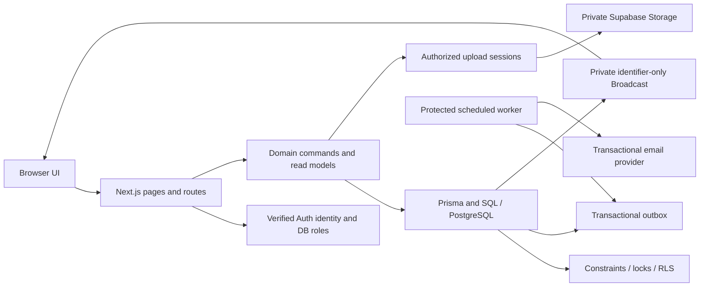

# Architecture audit — 2026-09-21

## Decision

Keep the current modular Next.js application and PostgreSQL architecture.
There is no evidence here that microservices, a new ORM, or a cloud migration
would improve the product enough to justify their operational cost. The
important immediate work is correctness, worker reliability, dependency
maintenance, and measuring database/browser limits.

This is a repository-wide review of the main architectural paths, not a
production capacity certification or an exhaustive proof of every line.
The review covered authentication/authorization, buyer saves and projections,
seller search and invites, document uploads, messaging/LOI, outbox/maintenance,
schema/migration contracts, frontend state, dependencies, and CI/release gates.
Focused code review was split across independent reviewers, followed by an
independent review of the fixes.

## Plan and scope

Goal: simplify agent instructions, understand the architecture, and implement
demonstrated improvements without replacing sound components.

1. Align AGENTS.md with official OpenAI guidance — completed.
2. Trace domain, persistence, security, and delivery boundaries — completed.
3. Reproduce and fix concrete defects — completed; regressions and checks below.
4. Record remaining operational/capacity work — completed.

Non-goals: Azure migration (the user clarified Codex instruction guidance),
new product features, deployment, shared database mutations, and schema changes.

## Architecture worth retaining

- Auth verifies the Supabase user and immutable UUID/email binding, then reads
  current status/roles from the database. Seller approval is a separate gate.
- Explicit read models keep private identity, evidence, Storage paths, and
  precise location out of public/seller projections.
- PostgreSQL enforces important cross-request rules, including property identity
  versions, evidence bindings, quotas, immutable records, and ownership.
- Seller search filters in SQL with keyset pagination and a unique tiebreaker;
  it does not fetch a capped candidate set and filter it in JavaScript.
- Canonical geography replaces ambiguous runtime ZIP/city inference.
- Messaging and LOI have separate state machines, participant checks, immutable
  history, ordered locks, retry fingerprints, and private realtime topics.
- Transactionally created outbox work separates durable business writes from
  external delivery. This is an appropriate base for multiple app instances.
- Migration history is immutable, fresh-install baselines are checked, and
  guarded release workflows distinguish local checks from real database proof.

## Implemented findings

| Priority | Finding and impact | Change and regression evidence |
| --- | --- | --- |
| P1 | Next 16.2.6 and tooling had 20 npm audit findings, including a critical runtime package advisory. | Updated Next to 16.3.5 and patched the dependency graph; full and production-only audits now report zero. |
| P1 | Cleanup could delete an uploaded object after another request finalized it; stale rejection/expiry could regress FINALIZED. | Atomically expire eligible sessions before Storage removal; conditional state transitions preserve finalized evidence. Five new lifecycle cases failed before the fix. |
| P1 | Unread-email SQL referenced `buyer_user.roles` without joining that alias, making eligible deliveries fail. | Added the missing buyer-account join. Actual PostgreSQL tests cover both recipients and role loss. |
| P1 | Batch-leased email jobs waited behind slow provider requests; expired/reassigned work could be sent or have its state overwritten. | Claim one job immediately before processing, renew the owned unexpired lease before sending, and fence state transitions by worker, attempt, and lease. PostgreSQL cases exercise delayed and overlapping workers. |
| P2 | A crash during the final email attempt stranded SENDING rows permanently. | Bounded claim sweep terminalizes exhausted expired leases while preserving active final attempts. |
| P2 | LOI submission/counter notices could send after the deadline until scheduled expiry ran. | Check the effective current revision deadline; preserve committed terminal-event mail. Exact-deadline SQL regression failed before the fix. |
| P2 | Blank buyer form fields became undefined Prisma updates, retaining obsolete preferences. | Full-form saves explicitly clear optional scalar values to null and retain valid zero values. |
| P2 | Buyer saves read/create the profile without first serializing on and rechecking its owner. | Lock the User before reading the profile; recheck ACTIVE and BUYER on every serializable retry. Ten command tests cover these save contracts. |
| P2 | Cursor searches treated badges as valid at first-page time while DTOs evaluated expiry at current time. | Share request time across badge predicates/ranking and DTO selection; retain the initial insertion cutoff. Four actual PostgreSQL regressions failed before the fix. |
| P2 | Clear/chip/history navigation updated seller results while filter controls retained stale values. | Key the filter form by applied URL filters; pagination/view-only changes preserve its state. |
| P3 | Conversation reads ran an unused follow-up count query; lint failed and one stale source-text test blocked CI. | Removed the unused read query/parameter and replaced the obsolete role assertion with ten session behavior tests. Send-side enforcement remains. |

Main changed code: `apps/web/server/buyer/commands.ts`,
`apps/web/server/uploads/service.ts`, `apps/web/server/email-outbox.ts`,
`apps/web/server/seller-search-query.ts`, `apps/web/server/contracts.ts`,
`apps/web/server/messaging/service.ts`, and
`apps/web/app/seller/search/page.tsx`, plus adjacent regression tests.

## Agent instructions and dependencies

Root AGENTS.md now gives the repository map, essential boundaries, commands,
and completion criteria. It permits justified refactors/dependencies and routine
authorized work without repeated approval. Product/privacy rules remain.
This follows [OpenAI AGENTS.md guidance](https://learn.chatgpt.com/docs/agent-configuration/agents-md)
and [OpenAI best practices](https://learn.chatgpt.com/guides/best-practices).

Next 16.3 automatically generated nested AGENTS.md/CLAUDE.md files during smoke
tests. `agentRules: false` in `apps/web/next.config.mjs` disables that documented
scaffolding feature so the maintained root instructions stay authoritative.
The generated files were removed; root instructions link to installed Next docs.
The standard generated `next-env.d.ts` root-params import is retained.

| Dependency change | Rationale / tradeoff |
| --- | --- |
| Next + eslint-config-next 16.3.5 | Patched same-major runtime and matching lint integration. [Windows RCE advisory](https://github.com/vercel/next.js/security/advisories/GHSA-p293-qw3h-jr36), [image processing advisory](https://github.com/vercel/next.js/security/advisories/GHSA-2xp9-vwfh-vxw4). |
| Vitest 4.1.11 in all workspaces | Patched test tooling. |
| Hono 4.13.8, @hono/node-server 1.19.17, PostCSS 8.5.28 | Updated existing security overrides. |
| @prisma/config -> deepmerge-ts 8.0.0 | Scoped major override closes stack exhaustion. Reviewed v8's breaking changes: Map/Into/type changes do not affect Prisma's plain-object config merger here. Both configs validate and client generation passes. Remove after Prisma adopts a patched dependency. [Release notes](https://github.com/RebeccaStevens/deepmerge-ts/releases/tag/v8.0.0). |
| @prisma/dev -> Valibot 1.5.0; Prisma -> mysql2 3.24.4 | Scoped same-major tooling overrides; no change to the PostgreSQL runtime adapter. Remove when upstream pins are patched. |
| @electric-sql/pglite 0.4.1, dev only | Makes an existing transitive test engine explicit so normal CI can execute critical SQL without shared database access. Small fixture schemas do not replace full-schema/RLS/concurrency proof. |
| Compatible lockfile updates | Non-force npm audit fix patches the remaining transitive findings. No forced downgrades, Prisma major upgrade, or new runtime service. |

The lockfile was updated with the repository-declared npm 10.9.0. Existing
Prisma/client/adapter remain 7.8.0. Recheck the overrides during future upgrades.

## Remaining findings and next decisions

| Priority | Evidence / risk | Recommended next step |
| --- | --- | --- |
| P1 launch gate | `vercel.json` has no scheduled jobs; preview docs explicitly disable schedules. Local readiness lacks AUTH_RATE_LIMIT_PEPPER, CRON_SECRET, RESEND_API_KEY, RESEND_FROM_EMAIL, and SITE_URL. | Configure the target environment and restore scheduled workers with heartbeat proof before public launch. Local findings do not establish the deployed environment's settings. |
| P1 launch gate | Sensitive document malware scanning is not integrated; `UPLOAD_MALWARE_SCANNING.md` records missing private-processing credentials/terms. | Finish real quarantine/scanning and provider proof before admitting public uploads. Signature/MIME checks are not malware scans. |
| P2 capacity | Signed-in previews deliberately load every eligible buyer; notification, invite, and some admin lists are unbounded. | Define paginated/aggregated preview UX and bounded operational lists, then measure response size, query latency, and browser memory. Preserve access/privacy contracts. |
| P2 capacity | Search index candidates remain in `SELLER_SEARCH_SQL_PROPOSAL.sql`; the optional 25K benchmark creates them on temporary tables. | Run representative EXPLAIN ANALYZE on a disposable copy with realistic skew and write rates; promote only measured indexes through forward migrations. Current evidence cannot establish production capacity. |
| P2 operations — fixed in follow-up | `auth-operations.ts` retained batch leases and excluded exhausted attempts from reclaim. | The public-launch verification follow-up now claims one job at a time, renews/fences owned leases, counts actual transitions and terminalizes exhausted expired attempts. Ten PGlite regressions cover recovery/stale workers; actual provider timeout and multi-connection proof remain release checks. |
| P2 correctness | `maintenance.ts` reads expiry candidates before updating and derives notices from those snapshots; concurrent workers/renewal can yield duplicate or stale notices. Processing is one unbounded transaction. | Use bounded atomic transitions with returned affected rows and notification derivation in the same transaction; prove renew/accept/expiry races against the real schema. |
| P2 lifecycle | `sendInvite` and its database uniqueness invariant treat overdue unprocessed SENT/VIEWED rows as active duplicates. | Restore maintenance first; evaluate expiry-on-write with an explicit lock/migration plan so the next invite cannot conflict with an obsolete row. |
| P3 UX | Public/seller location submit handlers lack the stale-request protection present in property lookup; provider failures can be described as unsupported geography. | Add abort/revision handling and distinguish temporary failure in a focused UI pass with browser coverage. |
| P3 maintainability | `contracts.ts` and LOI service are large, but already have domain modules. | Extract coherent areas when changing them; avoid a wholesale repository reshuffle. |

No extra service or distributed cache is justified by measured evidence yet.
Track p95 request/query latency, DB connections/wait time, payload sizes, outbox
age, exhausted jobs, and worker heartbeats before choosing the next scaling step.
The existing pool default of two connections per process needs deployment-wide
capacity sizing, not an arbitrary increase.

## Verification and limits

- `npm test`: passed — 405 web tests, 31 validator tests, and 40 Node script
  tests; baseline consistency and messaging/LOI static migration checks passed.
  Sixteen gated database/staging tests remain skipped.
- `npm run typecheck`, `npm run lint`, `npm run build`: passed.
- `npm run db:generate`, `npm run db:validate`, and
  `npx prisma validate --config prisma.baseline.config.ts`: passed.
- `npm run smoke:routes`, `npm run smoke:security`,
  `npm run smoke:no-auth-bypass`, `npm run smoke:secrets`: passed.
- `npm audit` and `npm audit --omit=dev`: zero findings.
- `npm run readiness:env`: local readiness passed with the production-setting
  warnings listed above. Production readiness was not certified.
- Browser: production homepage/map rendered with four guest previews and no
  captured console errors; buyer navigation and both signup presentation steps
  worked. No account was created. Authenticated seller filter interactions were
  not exercised with a real seller session.
- `git diff --check`: passed.

No migrations, secrets, environment values, shared data, or deployments were
changed. Tests use mocks for selected service boundaries and isolated PostgreSQL
for critical SQL; no full-schema fresh/upgrade, live RLS/Storage, external email,
malware provider, or multi-connection database contention proof was performed.
Those release gates remain required. Provider idempotency is still needed when a
request is already in flight at lease expiry; this is not exactly-once delivery.

Architecture and relevant section docs were updated. V1 product documentation
was corrected to remove a stale contradiction about the already-approved
preview ADMIN grant; no product scope expansion was introduced.
